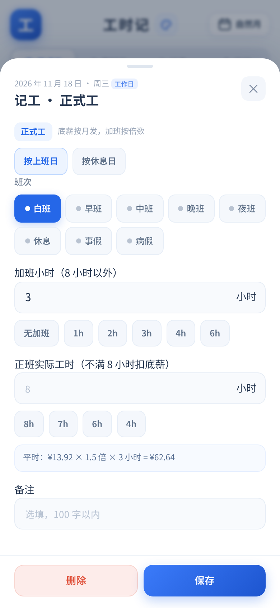
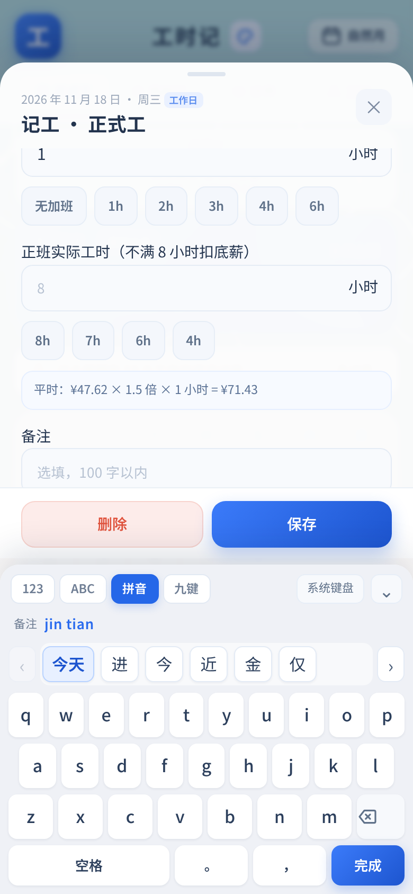

# 工时记 · 记工时，算工资

一个**单文件离线**的记工小应用：每天点几下，记下上了什么班、加了几小时，月底自动算出该拿多少钱。

四种工种：正式工（底薪 + 加班）、临时工（工时 × 单价）、计件（数量 × 单价）、工地（点工 / 包工 / 小时）。

没有账号、不联网、数据只存在你自己这台手机里。

<p align="center">
  
  
  
</p>

---

## 仓库里有什么

| 文件 | 说明 |
|---|---|
| `工时记-1.0.apk` | Android 安装包（1.0，约 0.9 MB，内置键盘可用） |
| `工时记-单文件.html` | 单文件网页版，用浏览器打开就能用，功能完全一样 |
| `build-src/` | 网页源码。按功能拆成 20 多个小文件，用 `build.sh` 拼成 HTML |
| `build-src/test/` | 自动化测试（jsdom），t1–t12 |
| `gongshiji-app/` | Android 工程（WebView 壳 + 打包脚本），用来重新打 APK |
| `screenshots/` | 界面截图 |
| `docs/` | 每一版的交付说明 |

> `build-src/` 能**逐字节**重新生成 `工时记.html` 和 `keypad.js`，单文件版由脚本把两者合并。APK 里内嵌的就是单文件版。

Releases 里也挂了同样两份成品，文件名换成了英文（GitHub 会把中文资源名吃掉）：[`gongshiji-1.0.apk`](https://github.com/guomeihuang4-bot/gongshiji/releases/download/v1.0/gongshiji-1.0.apk) 和 [`gongshiji-1.0-single.html`](https://github.com/guomeihuang4-bot/gongshiji/releases/download/v1.0/gongshiji-1.0-single.html)。

## 怎么用

三种方式，挑一种就行。

### 方式一：装 APK（推荐）

1. 点开 [`工时记-1.0.apk`](https://github.com/guomeihuang4-bot/gongshiji/raw/main/工时记-1.0.apk) 下载
2. 手机上点安装（首次安装会提示"允许安装未知来源应用"，允许即可）
3. 打开「工时记」

系统要求 Android 7.0 及以上（minSdk 24）。

**这一版换了新包名** `com.deepseekharness.gongshiji`（旧的 4.1f 是 `com.dsha.gongshiji`），两个版本可以同时装着，互不覆盖。旧版的数据不会自动过来，需要先在旧版「设置 → 数据与备份」导出 JSON，再在新版导入。

### 方式二：浏览器打开 HTML

把 `工时记-单文件.html` 下载到手机，用浏览器打开即可。也可以直接在浏览器里访问，但**这样每次都要联网**，不如存本地。

想加到桌面当 App 用：浏览器菜单 →「添加到主屏幕」。

### 方式三：自己构建

网页部分：

```bash
cd build-src
bash build.sh
# 输出：../工时记.html      主程序
#       ../keypad.js       键盘模块
#       ../工时记-单文件.html  两者合并，发人 / 打包用
```

不需要 Node 或任何依赖，`build.sh` 就是 `cat` 按顺序拼接 + 一次内联替换。

APK 部分（需要 Android SDK 和 Gradle）：

```bash
bash deploy-assets.sh          # 把单文件版放进 assets/index.html
cd gongshiji-app
bash build.sh assembleRelease  # 产物在 app/build/outputs/apk/release/
```

`gongshiji-app/build.sh` 里默认 `ANDROID_HOME=/opt/android-sdk`，换成你本机的 SDK 路径（或先 `export ANDROID_HOME=...`），再建一个 `local.properties` 写 `sdk.dir=/你的/sdk/路径`。

**仓库里不含签名密钥**。要打 release 包，自己生成一个 jks，并在 `local.properties` 里配（该文件已被 gitignore）：

```properties
gongshi.storeFile=../你的签名.jks
gongshi.storePassword=***
gongshi.keyAlias=***
gongshi.keyPassword=***
```

只想装上自测的话，直接 `bash build.sh assembleDebug` 用 debug 签名即可，不用配密钥。

跑测试（可选）：

```bash
cd build-src/test
npm i jsdom
bash run-all.sh
```

## 第一次打开先做这件事

打开后先到 **设置 → 工资参数**，把值改成你自己的情况。默认值只是示例：

| 项 | 默认 | 说明 |
|---|---|---|
| 月薪（底薪） | 2450 元/月 | 你的月薪 |
| 每月计薪天数 | 22 天 | 法定标准是 21.75 天 |
| 每天标准工时 | 8 小时 | 超过就算加班 |
| 平时/周末/节假日加班 | 1.5 / 2 / 3 倍 | 可以改 |

填了底薪和天数，下面会自动算出**时薪**（默认 2450 ÷ (22×8) = ¥13.92/时），加班费按这个时薪乘倍数算。时薪也可以手动改。

## 四种工种

顶部四个标签页就是四种工种。**每个工种的数据、日历、明细、工作日设置都是独立的**，互不影响。

| 工种 | 怎么算钱 | 适合 |
|---|---|---|
| **正式工** | 底薪按月发；加班按时薪×倍数；事假/病假/正班缺勤扣底薪 | 有固定月薪、要算加班费的 |
| **临时工** | 工时 × 小时单价 | 按小时结算的零工 |
| **计件** | 数量 × 单价（可维护品项表，记工时直接选品项自动带价） | 计件工资 |
| **工地** | 点工（1 个工＝一天日薪，可填 0.5 半天）＋ 包工（数量×单价）＋ 小时 ＋ 加班单价；借支单独记账，不参与工资 | 工地记工 |

## 每天怎么记工

1. **日历页** 上点今天的日期（或任意一天）
2. 弹窗里选**班次**：白班 / 早班 / 中班 / 晚班 / 夜班 / 休息 / 事假 / 病假
3. 填**加班小时**（8 小时以外的部分）——下面有 1h、2h、3h 等快捷键
4. 如果当天没上满 8 小时，改「正班实际工时」，会按缺勤扣底薪
5. 公司不按法定倍率算？点开「加班倍率」可以拆成平时 / 周末 / 节假日三段，总小时不变
6. 弹窗底部会**实时算出这一天的钱**（例：平时 ¥13.92 × 1.5 倍 × 3 小时 = ¥62.64）
7. 点**保存**

同一天再点一次就是修改，里面有「删除」可以清掉。

日历上每天会显示加班时长和当天加班费；不是工作日的日期右上角标「休」；顶部蓝色卡片是本月工资、上班天数、加班小时数。

## 结算本月

日历页本月工资旁有个「结算本月」按钮。默认显示**整月全额**；点一下改成**只按已经记过工的日子折算**：

```
底薪 = 月薪 × 已记录应出勤天数 ÷ 本周期应出勤天数
```

- 记了白班/早班/中班/晚班/夜班 → 算一天
- 事假算一天底薪，再扣一天，净 0，不会双扣
- 病假带薪，不扣
- 休息、没记录 → 不算
- 开关是全局的，所有月份一起变；点「恢复整月」随时切回来，数据不丢

## 调休抵扣

**设置 → 正式工 → 调休抵扣**：填本月调休小时，选「先扣低倍率」或「先扣高倍率」，明细里加班费会自动扣掉这部分，并写明每档剩多少、抵了多少。调休超过加班总额时会提示「多出 X 小时未抵扣」，不会算成负数。

## 对外单价

临时工「对外单价（报价）」、工地「对外单价」三项。填了以后明细多一行「应收（按对外价）」和「差额」；不填就和到手价一样，界面不多东西。

## 工资是怎么算出来的

**正式工**

```
时薪   = 月薪 ÷ (每月计薪天数 × 每天标准工时)
日工资 = 时薪 × 标准工时
加班费 = 时薪 × 倍数 × 加班小时
实发   = 底薪 + 加班费 + 补贴 - 扣款(社保/公积金) - 底薪扣款(事假/病假/缺勤)
```

设置里可以打开「按当月工作日自动算计薪天数」，这样 2 月、有调休的月份会自动按实际工作日折算，不用手动改天数。

**临时工** = 工时 × 小时单价
**计件** = 数量 × 单价
**工地** = 点工数 × 日薪 + 包工(数量×单价) + 小时数×时薪 + 加班小时×加班单价

明细页（底部第二个标签）会把上面每一项拆开列给你看，底部还有出勤统计。

## 自带输入法

App 内置了一个**不联网的输入法**，用来填备注、填数字，不用调系统键盘。

- 五种模式：`123` 数字、`ABC` 英文、`拼音` 26 键、`九键` T9、`手写`
- 约 18500 条常用词，支持整句：`wojintianjiaban` → 我今天加班
- 支持简拼：`jt` → 今天
- 手写：半屏手写板，用手指写字，停笔约 0.2 秒出候选，点一下上屏；9507 个汉字，完全离线
- 长按退格连删；候选词可以翻页
- 不想用内置键盘时，在「关于」里点「改用手机自带键盘」，随时能换回来

<p align="center">
  
</p>

## 工资周期

默认是自然月（1 号到月底）。如果你公司是 **26 号发工资、算到次月 25 号**：

顶栏「自然月」按钮 → 点「调整工资周期」 → 拨到 26 号 → 下月 25 号。

日历、明细、工资条会跟着变。周期是**全局的，四种工种共用**。

## 换壁纸

点标题右边的调色板图标 → 选一张相册里的照片。然后可以调三个滑块：

- 模糊：0–20px
- 压暗：0–75%
- 卡片透明度：10–100%（拉到 55% 以下，照片就能透出来）

<p align="center">
  
</p>

## 备份、导出与工资条

**设置 → 数据与备份**：

| 功能 | 说明 |
|---|---|
| 导出完整备份 | 四种工种的全部记录和设置，存成 JSON |
| 导入备份 | 合并同一天的记录，**不会清空**现有数据 |
| 导出当前工种 CSV | Excel / WPS 直接打开 |
| 工资条 | 预览、打印，或存成图片 |
| 清空当前工种 | 只清当前工种，其他不受影响 |

**换手机、刷机、卸载前，一定先导出一份备份。** 数据只存在这台手机上，没有云端。

## 隐私

- APK **不申请网络权限**（Manifest 里只有 `VIBRATE`），装完在系统层面就没法联网
- 没有账号、没有登录、没有统计、没有广告
- 数据存在本机 App 私有目录，卸载即删
- 手写识别、拼音词库全部内置在本机，写字过程不上传
- 关于页里的「一键复制」只是复制当前页面的 HTML 源码，不上传任何东西

## 许可与第三方组件

内置键盘的**手写识别**用到了 GPL v3 的 HanziLookupJS 和 Arphic Public License（文鼎公共许可）的字库。按 GPL 的规则，把内置键盘打包进你的程序再分发，整个程序就要以 GPL 兼容的方式开源——作者本人不介意，项目本来就是公开源码。

只想用记工功能、不想被 GPL 约束的话，**建议把内置键盘整套去掉**，改用手机自带输入法：主程序不含 GPL 代码，去掉键盘后可以自己决定怎么处理。具体做法和组件清单见 [`docs/第三方组件与许可.md`](docs/第三方组件与许可.md)。

## 常见问题

**Q：装的时候提示"应用未安装"？**
A：这一版换了新包名，和旧版不冲突。如果装的是更早的、同包名不同签名的版本，先卸载旧版再装（先导出备份）。

**Q：旧版的数据怎么迁过来？**
A：旧版 → 设置 → 数据与备份 → 导出完整备份；新版 → 同一位置 → 导入备份。

**Q：数据会不会丢？**
A：不卸载就不丢。卸载、清数据、换手机前先导出 JSON 备份。

**Q：节假日显示不对？**
A：内置 2025–2030 的节假日。国务院临时调整时，在记工弹窗里手动把那天改成「上班」或「休息」就行。

**Q：能打印吗？**
A：可以。工资条 → 打印，需要手机上有打印服务；没有就选「存成图片」。

**Q：手写认不准？**
A：手写依赖大致正确的笔顺，一次认一个字；形近字（口/囗、工/土）点候选即可。认不出就切拼音或系统键盘。

## 已知限制

- 2027 年以后的节假日按标准推算，可能与实际公布有出入
- 拼音词库是常用词，生僻人名地名可能没有
- 手写一次只认一个字，依赖笔顺，连笔草书识别率下降
- 打印依赖手机自带的打印服务

## 版本

当前 **1.0**（versionCode 1）。变更记录见 [`docs/交付说明-v1.0.md`](docs/交付说明-v1.0.md)。

作者：deep seek · 遇到问题请自行维护或者卸载，重新打包 app 就是你的了。
